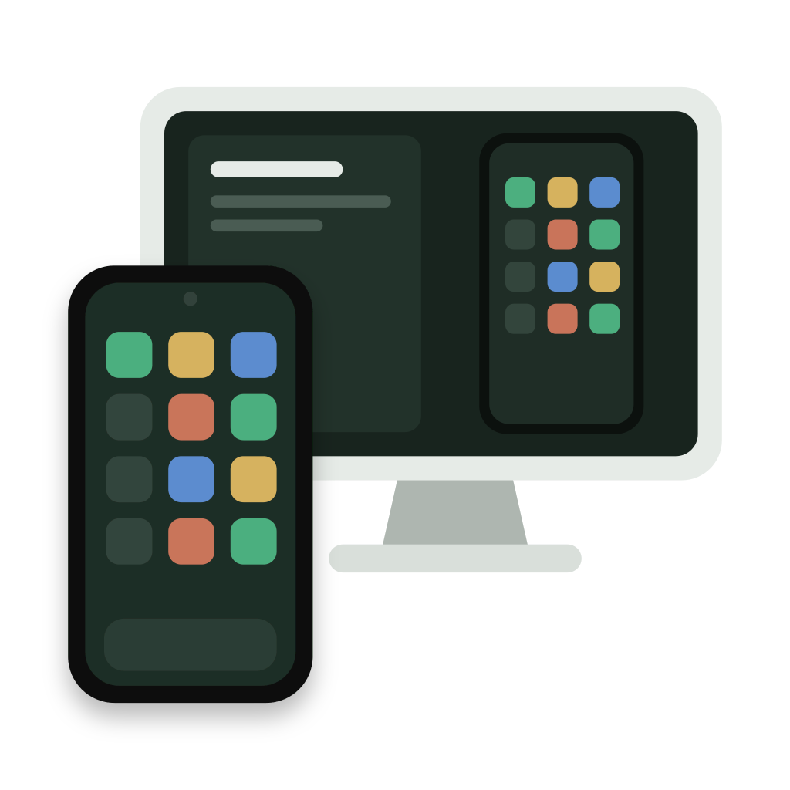
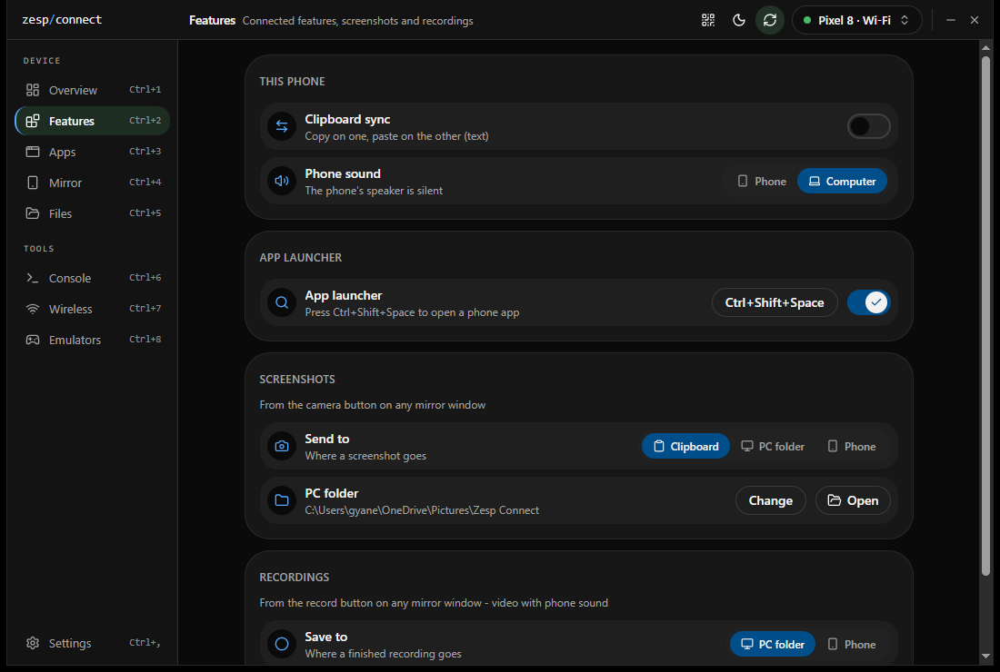
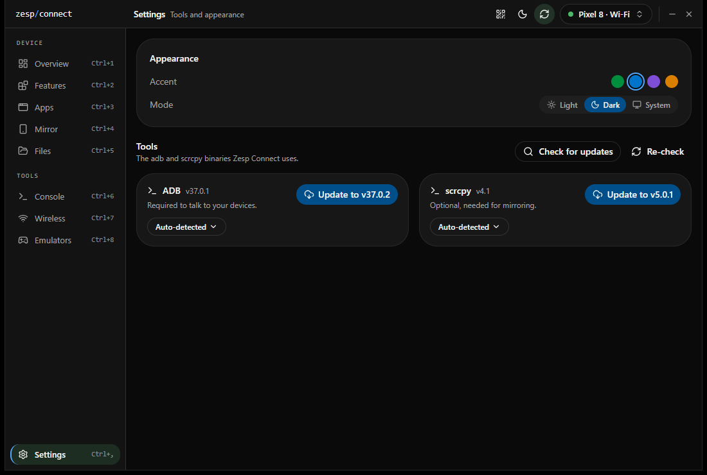

<div align="center">



# Zesp Connect

**Your Android phone, on your desktop.**

Mirror the screen, hear the phone's sound, share the clipboard, move files and control
apps from one fast, lightweight window. No companion app, no account, no cloud.

[](https://github.com/GauravGhost/ZespConnect/actions/workflows/ci.yml)
[](https://github.com/GauravGhost/ZespConnect/releases)
[](LICENSE)


[Download](https://github.com/GauravGhost/ZespConnect/releases) ·
[Features](#features) ·
[Getting started](#getting-started) ·
[Build from source](#building-from-source) ·
[Changelog](CHANGELOG.md) ·
[Contributing](#contributing)


</div>

## What is Zesp Connect?

Zesp Connect is a free, open source desktop app that connects your Android phone to your
Windows, macOS or Linux computer. Plug in a USB cable or pair over Wi-Fi, and your phone
becomes part of your desktop: its screen in a window, its apps one shortcut away, its sound
in your headphones and its clipboard shared with your computer.

It is built on two proven open source tools, Android's
[adb](https://developer.android.com/tools/adb) and
[scrcpy](https://github.com/Genymobile/scrcpy), and wraps them in a clean interface so you
never have to touch a terminal.

## Why I built it

During a working day my phone and my computer felt like two separate worlds. A message
arrived on the phone and I had to pick it up. A photo had to be emailed to myself. A link
copied on the laptop could not be pasted on the phone.

The tools that bridge this gap each had a catch:

- **scrcpy and adb** are excellent, but they live in the terminal and every feature is a
  flag you have to remember.
- **Phone link apps** need a companion app on the phone, an account, or a specific brand of
  phone or computer, and some route data through the cloud.
- **All-in-one device managers** are often closed source, heavy, or full of ads.

Zesp Connect is the tool I wanted: everything adb and scrcpy can do, in one friendly
window, on every desktop platform, with nothing to install on the phone and nothing leaving
your own network. It is also designed to stay light. Devices are tracked through events
rather than polling, so the app sits quietly in the tray until you need it.

## Features

### Mirror and control

- **Screen mirroring** with mouse, touch and keyboard input, in a resizable window with
  always-on-top and a hover control bar.
- **Open a single app in its own window**, or mirror a camera or Android desktop mode.
- **Screenshots and recordings** from any mirror window, with the phone's sound included in
  recordings (Android 13+). Save to a folder or copy straight to the clipboard.
- **Drag and drop** files onto a mirror window or the main window to send them to the phone.
- **Enter sends** in WhatsApp and Telegram windows, Shift+Enter for a new line.

### Stay connected

- **Phone sound on your computer.** Route audio to the phone or the computer per device
  (Android 11+).
- **Two-way clipboard sync.** Copy on one side, paste on the other.
- **Now playing.** See what is playing on the phone and control it from the desktop.
- **App launcher.** Press `Ctrl+Shift+Space` (`Cmd+Shift+Space` on macOS) anywhere to search
  and open a phone app in its own window. The shortcut can be changed.

### Manage your device

- **Apps.** Browse installed apps by their real names, then launch, uninstall, clear data or
  install an APK.
- **Files.** Browse storage, upload and download, create folders, and preview images,
  videos, audio, PDFs and text without downloading them first.
- **Quick controls.** Toggle Wi-Fi, Bluetooth, mobile data, dark mode, Do Not Disturb and
  rotation, adjust brightness and volume, or reboot.
- **Console.** Run `adb shell` commands and stream logcat with colour-coded severity.
- **Emulators.** List, see and boot your Android Virtual Devices.

### Wireless, the easy way

- **Pair with a QR code** or a six-digit code, or switch a USB device to Wi-Fi in one click.
- **Automatic discovery** of phones on your network.
- **Auto-reconnect.** Saved phones reconnect on their own when they come back on the network.

### Built for the desktop

- **Live device detection.** USB and Wi-Fi connections to the same phone appear as one
  device.
- **System tray** with quick actions and optional launch at startup.
- **Guided setup.** Finds `adb` and `scrcpy` automatically, or helps you install them.
- **Light and dark themes** with several Material You inspired colour presets.

## Screenshots

| Features                                   | Apps                               |
| ------------------------------------------ | ---------------------------------- |
|  |  |

| Mirror                                 | Files                                |
| -------------------------------------- | ------------------------------------ |
|  |  |

| Wireless                                   | Console                                  |
| ------------------------------------------ | ---------------------------------------- |
|  |  |

| Emulators                                    | Settings                                   |
| -------------------------------------------- | ------------------------------------------ |
|  |  |

## Getting started

### 1. Install the app

Download the installer for your platform from the
[Releases](https://github.com/GauravGhost/ZespConnect/releases) page.

| Platform | Package                                  |
| -------- | ---------------------------------------- |
| Windows  | `.msi` or `.exe`                         |
| macOS    | `.dmg` (Apple silicon and Intel, 10.15+) |
| Linux    | `.AppImage` or `.deb`                    |

### 2. Get the tools

Zesp Connect needs two free tools on your computer. If either is missing, the app offers to
install it for you on first launch.

- [adb](https://developer.android.com/tools/releases/platform-tools) (Android platform-tools)
- [scrcpy](https://github.com/Genymobile/scrcpy) 3.x or later, for mirroring, sound and
  clipboard sync

### 3. Prepare your phone

1. Open **Settings → About phone** and tap **Build number** seven times to enable developer
   options.
2. In **Settings → Developer options**, turn on **USB debugging** (and **Wireless
   debugging** if you want to connect over Wi-Fi).
3. Connect the phone with a USB cable and accept the prompt on the phone, or pair it from
   the **Wireless** page.

Your phone appears in the app within a second or two.

## Privacy

Zesp Connect talks to your phone directly over USB or your local network using adb. It has
no account, no telemetry, no cloud service and nothing to install on the phone. Your screen,
sound, files and clipboard never leave the devices you connect.

## Building from source

### Prerequisites

- [Node.js](https://nodejs.org) 20 or later
- [Rust](https://www.rust-lang.org/tools/install) (stable)
- The Tauri [system dependencies](https://tauri.app/start/prerequisites/) for your platform
- On Linux, the ALSA headers for phone sound (`libasound2-dev` on Debian/Ubuntu)

### Run in development

```bash
git clone https://github.com/GauravGhost/ZespConnect.git
cd ZespConnect
npm install
npm run tauri dev
```

### Build a release bundle

```bash
npm run tauri build
```

The installers are written to `src-tauri/target/release/bundle/`.

### Developing without a device

A fake `adb` script is included so you can work on the UI without a phone. In
**Settings → adb**, set the path to `scripts/fake-adb.sh` (macOS/Linux) or
`scripts/fake-adb.cmd` (Windows).

### Tech stack

[Tauri 2](https://tauri.app) and Rust for the backend, React, TypeScript and
[shadcn/ui](https://ui.shadcn.com) for the interface.

```
src/                     React frontend
├── app/                 App shell, store, providers, theme system
├── components/          Shared UI components
├── features/            One folder per feature (apps, mirror, wireless, ...)
├── hooks/               Shared hooks and backend event subscriptions
└── lib/ipc.ts           Typed wrappers for every backend command

src-tauri/src/           Rust backend
├── commands/            Thin Tauri command handlers
├── services/            Domain logic and adb/scrcpy output parsers (no Tauri types)
├── runtime/             Device tracker, mirror sessions, recording, reconnect
├── models/              Types shared with the frontend
├── tray/                System tray menu and actions
└── platform/            OS-specific window handling
```

External processes are always started with an argument array, never a shell string.
Device paths and package names are validated before they are used.

### Scripts

| Command                                          | Description                            |
| ------------------------------------------------ | -------------------------------------- |
| `npm run tauri dev`                              | Run the app in development mode        |
| `npm run typecheck`                              | Type-check the frontend                |
| `npm run lint` / `lint:fix`                      | Lint with ESLint                       |
| `npm run format` / `format:check`                | Format with Prettier                   |
| `npm run test`                                   | Run frontend tests (Vitest)            |
| `npm run rust:fmt` / `rust:clippy` / `rust:test` | Format, lint and test the Rust backend |

## Contributing

Contributions of all sizes are welcome: bug reports, feature ideas, documentation and code.

1. For larger changes, please [open an issue](https://github.com/GauravGhost/ZespConnect/issues)
   first to discuss the approach.
2. Fork the repo and create a branch for your change.
3. Make sure these pass before you open a pull request:

   ```bash
   npm run typecheck && npm run lint && npm run format:check && npm run test
   npm run rust:fmt && npm run rust:clippy && npm run rust:test
   ```

UI work should follow the theming guidelines in
[`src/app/theme/README.md`](src/app/theme/README.md).

<details>
<summary><strong>Releasing (maintainers)</strong></summary>

Add a section for the new version to [`CHANGELOG.md`](CHANGELOG.md) and commit it. Then
push a version tag. This builds installers for every platform, attaches them to a GitHub
release with that changelog section as the notes, and publishes it once every build
succeeds. If any build fails, the release stays a draft:

```bash
git tag v0.1.0
git push origin v0.1.0
```

The tag sets the version in `package.json`, `tauri.conf.json` and `Cargo.toml`.

Builds are unsigned by default. To enable code signing, add these repository secrets:

| Secret                         | Platform | Purpose                                        |
| ------------------------------ | -------- | ---------------------------------------------- |
| `APPLE_CERTIFICATE`            | macOS    | Base64-encoded Developer ID `.p12`             |
| `APPLE_CERTIFICATE_PASSWORD`   | macOS    | Password for the `.p12`                        |
| `APPLE_SIGNING_IDENTITY`       | macOS    | e.g. `Developer ID Application: Name (TEAMID)` |
| `APPLE_ID`                     | macOS    | Apple ID used for notarization                 |
| `APPLE_PASSWORD`               | macOS    | App-specific password for the Apple ID         |
| `APPLE_TEAM_ID`                | macOS    | Apple Developer team ID                        |
| `WINDOWS_CERTIFICATE`          | Windows  | Base64-encoded code-signing `.pfx`             |
| `WINDOWS_CERTIFICATE_PASSWORD` | Windows  | Password for the `.pfx`                        |

</details>

## Acknowledgements

- [scrcpy](https://github.com/Genymobile/scrcpy) by Genymobile, which powers mirroring, phone
  sound and clipboard sync
- [Tauri](https://tauri.app) and [shadcn/ui](https://ui.shadcn.com)

## License

Zesp Connect is released under the [MIT License](LICENSE).
