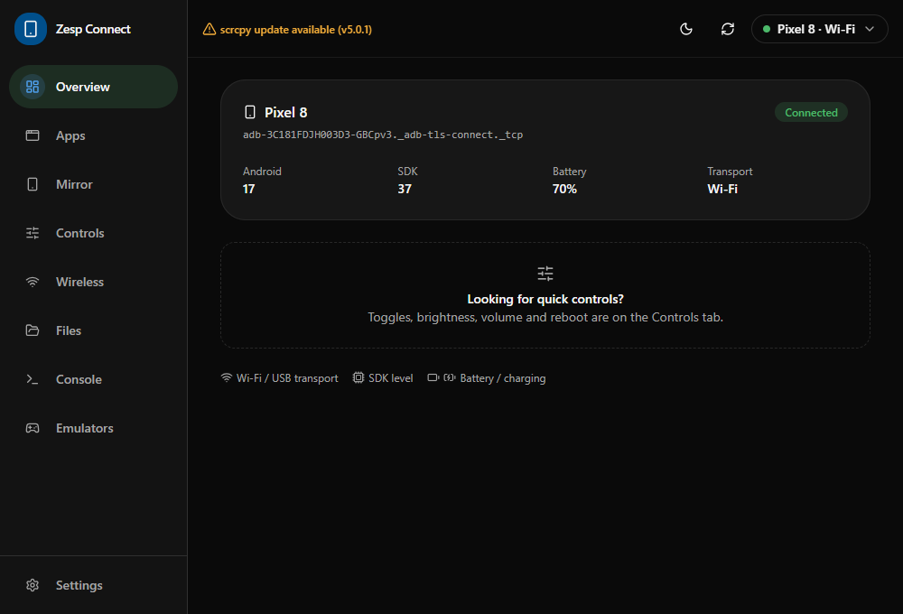
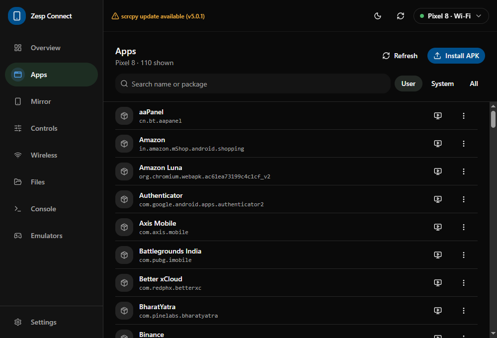
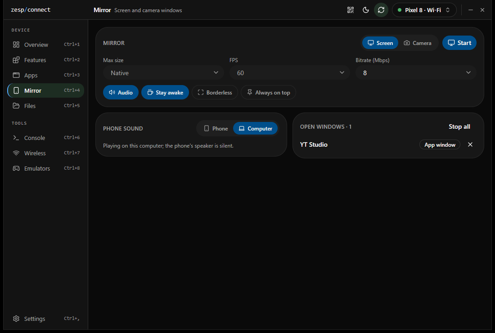
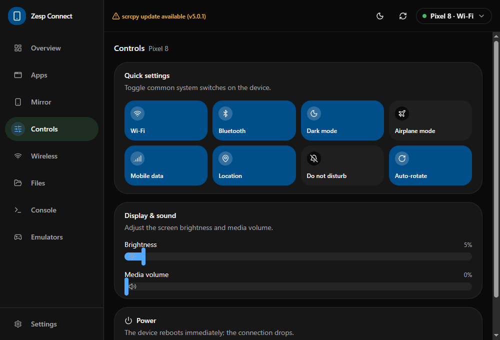
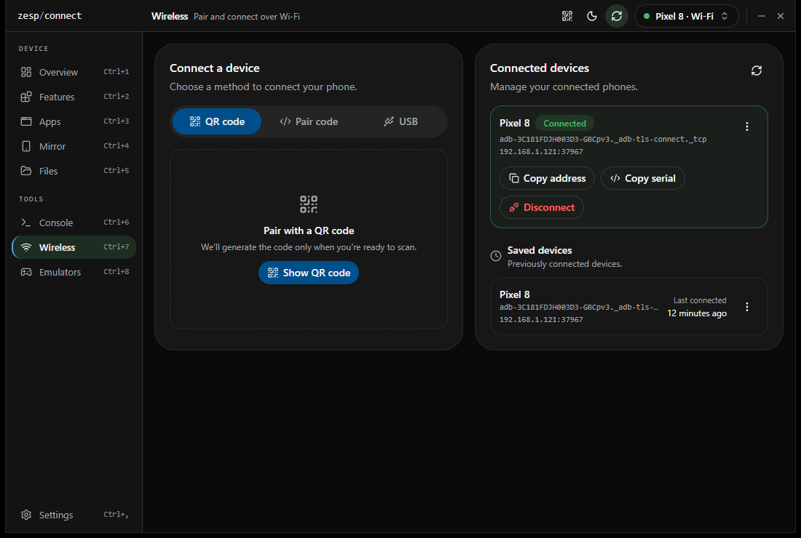
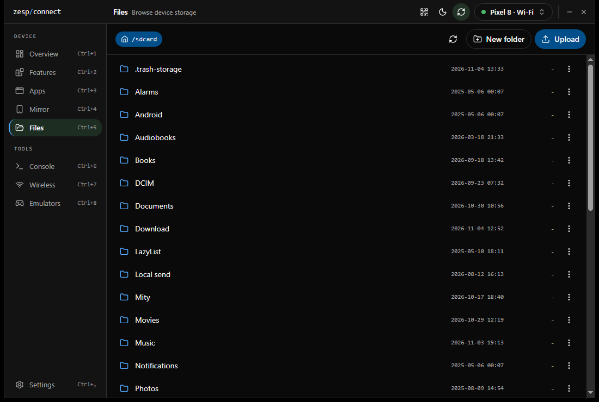
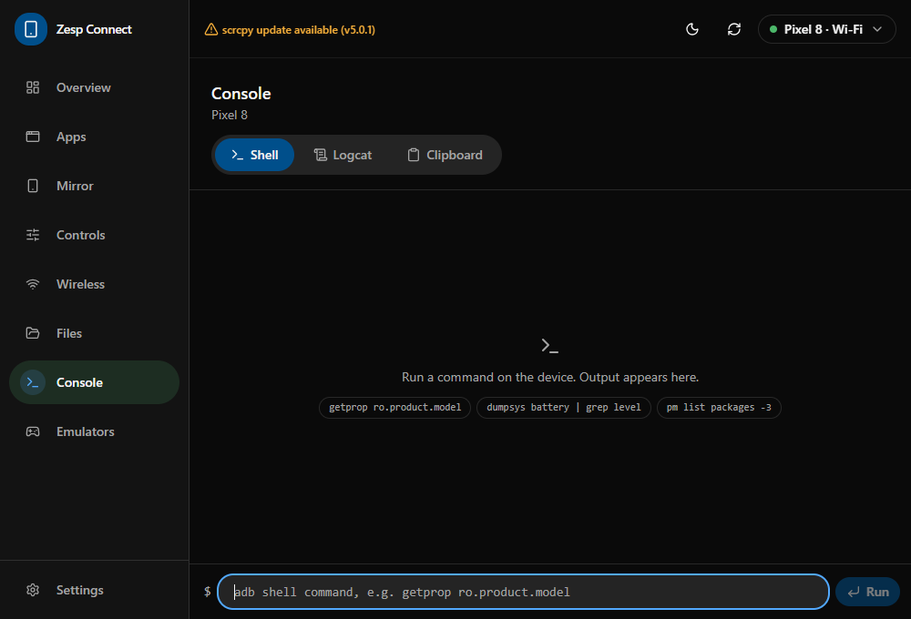

# Zesp Connect

A cross-platform desktop app for managing Android devices over **adb** and **scrcpy**.
Mirror your screen, manage apps, transfer files, pair over Wi-Fi and run shell commands,
all from one window on Windows, macOS and Linux.

Built with [Tauri 2](https://tauri.app), React, TypeScript and Rust.



## Features

- **Device management.** Devices are detected live through `adb track-devices` (no polling).
  USB and Wi-Fi connections to the same phone are merged into a single entry.
- **Screen mirroring.** Mirror the display, a device camera, or a single app in its own
  window. Sessions run inside the app with touch and keyboard input, always-on-top and
  aspect-ratio locking. Supports Android desktop (windowing) mode.
- **Connected features.** Switched per device from the Overview:
  - **Clipboard sync** - copy on the phone or the computer and paste on the other (text).
  - **Phone sound** - play the phone's sound on the phone or on the computer, also from the
    Mirror screen and any mirror window's title bar. Needs Android 11 or later.
- **App manager.** Lists installed apps by their real names, with search and filters.
  Launch, uninstall, clear data, or install an APK.
- **Quick controls.** Toggle Wi-Fi, Bluetooth, mobile data, dark mode, Do Not Disturb and
  rotation, adjust brightness and volume, and reboot, from a quick-settings style panel.
- **Wireless debugging.** Pair with a QR code or a six-digit code, discover devices on the
  network via mDNS, or switch a USB-connected device to Wi-Fi in one click.
- **File browser.** Browse device storage, upload and download files, create folders, and
  delete entries.
- **Console.** Run `adb shell` commands and stream logcat with severity colouring.
- **Emulators.** List Android Virtual Devices, see which are running, and boot them.
- **Tool management.** Finds `adb` and `scrcpy` automatically. You can also point to custom
  binaries, or install missing tools through your system package manager.
- **System tray.** Quick access to devices and common actions, plus an optional launch at
  startup.
- **Theming.** Light and dark modes with several Material You inspired colour presets.

## Screenshots

| Apps                               | Mirror                                 |
| ---------------------------------- | -------------------------------------- |
|  |  |

| Controls                                   | Wireless                                   |
| ------------------------------------------ | ------------------------------------------ |
|  |  |

| Files                                | Console                                  |
| ------------------------------------ | ---------------------------------------- |
|  |  |

## Installation

Download the installer for your platform from the
[Releases](https://github.com/GauravGhost/Zesp-Connect/releases) page:

| Platform | Package                          |
| -------- | -------------------------------- |
| Windows  | `.msi` or `.exe`                 |
| macOS    | `.dmg` (Apple silicon and Intel) |
| Linux    | `.AppImage` or `.deb`            |

### Runtime requirements

- [adb](https://developer.android.com/tools/releases/platform-tools) (Android platform-tools)
- [scrcpy](https://github.com/Genymobile/scrcpy) 3.x or later (required for mirroring)
- USB debugging (or Wireless debugging) turned on for your device

If either tool is missing, the app walks you through installing it on first launch.

## Building from source

### Prerequisites

- [Node.js](https://nodejs.org) 20 or later
- [Rust](https://www.rust-lang.org/tools/install) (stable)
- The Tauri [system dependencies](https://tauri.app/start/prerequisites/) for your platform
- On Linux, the ALSA headers for phone sound (`libasound2-dev` on Debian/Ubuntu)

### Run in development

```bash
git clone https://github.com/GauravGhost/Zesp-Connect.git
cd Zesp-Connect
npm install
npm run tauri dev
```

### Build a release bundle

```bash
npm run tauri build
```

The installers are written to `src-tauri/target/release/bundle/`.

### Developing without a device

A fake `adb` script is included, so you can work on the UI without a phone. In
**Settings → adb**, set the path to `scripts/fake-adb.sh` (macOS/Linux) or
`scripts/fake-adb.cmd` (Windows).

## Project structure

```
src/                     React frontend
├── app/                 App shell, store, providers, theme system
├── components/          Shared UI components
├── features/            One folder per feature (apps, mirror, wireless, ...)
├── hooks/               Shared hooks and backend event subscriptions
└── lib/ipc.ts           Typed wrappers for every backend command

src-tauri/src/           Rust backend
├── commands/            Thin Tauri command handlers
├── services/            Domain logic and adb/scrcpy output parsers (no Tauri types)
├── runtime/             Device tracker, mirror sessions, tool installation
├── models/              Types shared with the frontend
└── platform/            OS-specific window handling
```

External processes are always started with an argument array, never a shell string.
Device paths and package names are validated before they are used.

## Scripts

| Command                                          | Description                            |
| ------------------------------------------------ | -------------------------------------- |
| `npm run tauri dev`                              | Run the app in development mode        |
| `npm run typecheck`                              | Type-check the frontend                |
| `npm run lint` / `lint:fix`                      | Lint with ESLint                       |
| `npm run format` / `format:check`                | Format with Prettier                   |
| `npm run test`                                   | Run frontend tests (Vitest)            |
| `npm run rust:fmt` / `rust:clippy` / `rust:test` | Format, lint and test the Rust backend |

## Releasing

Pushing a version tag builds installers for every platform and attaches them to a
draft GitHub release:

```bash
git tag v0.1.0
git push origin v0.1.0
```

The tag sets the version in `package.json`, `tauri.conf.json` and `Cargo.toml`.

Builds are unsigned by default. To enable code signing, add these repository secrets:

| Secret                         | Platform | Purpose                                        |
| ------------------------------ | -------- | ---------------------------------------------- |
| `APPLE_CERTIFICATE`            | macOS    | Base64-encoded Developer ID `.p12`             |
| `APPLE_CERTIFICATE_PASSWORD`   | macOS    | Password for the `.p12`                        |
| `APPLE_SIGNING_IDENTITY`       | macOS    | e.g. `Developer ID Application: Name (TEAMID)` |
| `APPLE_ID`                     | macOS    | Apple ID used for notarization                 |
| `APPLE_PASSWORD`               | macOS    | App-specific password for the Apple ID         |
| `APPLE_TEAM_ID`                | macOS    | Apple Developer team ID                        |
| `WINDOWS_CERTIFICATE`          | Windows  | Base64-encoded code-signing `.pfx`             |
| `WINDOWS_CERTIFICATE_PASSWORD` | Windows  | Password for the `.pfx`                        |

## Contributing

Contributions are welcome. Before you open a pull request, please make sure these pass:

```bash
npm run typecheck && npm run lint && npm run format:check && npm run test
npm run rust:fmt && npm run rust:clippy && npm run rust:test
```

For larger changes, please open an issue first to discuss the approach. UI work should
follow the theming guidelines in [`src/app/theme/README.md`](src/app/theme/README.md).

## Acknowledgements

- [scrcpy](https://github.com/Genymobile/scrcpy) by Genymobile, which powers mirroring, phone
  sound and clipboard sync
- [Tauri](https://tauri.app) and [shadcn/ui](https://ui.shadcn.com)

## License

[MIT](LICENSE)
