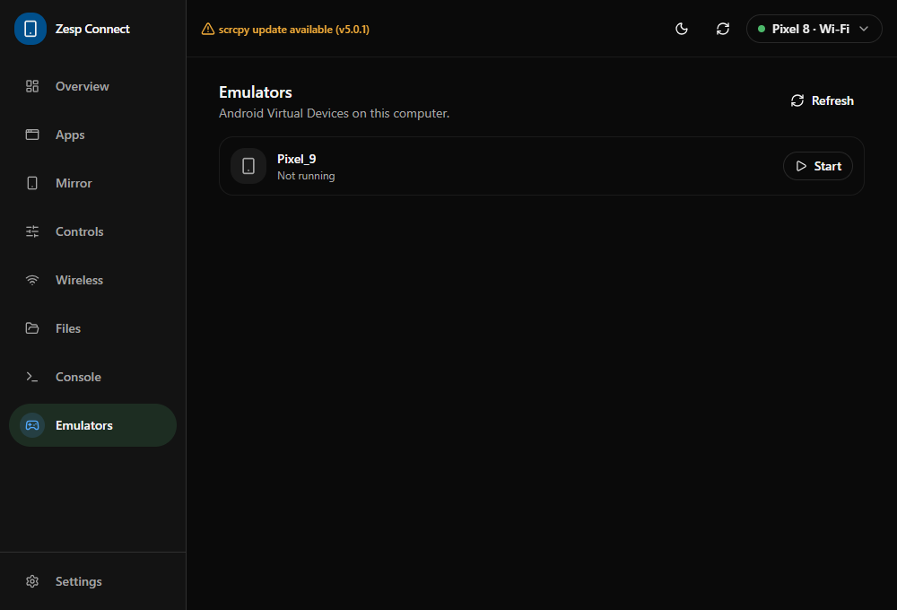

# Zesp Connect

A cross-platform desktop app (Windows, Linux, macOS) to manage Android devices over
**adb** and **scrcpy** - one codebase: **Tauri 2 + React + TypeScript + Rust**.

Zesp Connect lists your devices, shows real app names (not package ids), mirrors the
screen and camera, drives quick toggles, browses files, exposes an adb console and
handles wireless pairing - all from a single window.

> Status: **M0-M6** are implemented - the architecture skeleton, tool discovery, the push-based
> device tracker (`adb track-devices`), device list/dedupe, the header switcher, onboarding,
> the system tray, an installed-apps manager (real names, search/filter, launch, uninstall, clear
> data, install APK), mirroring (screen, camera, and app windows with the Android 12-13
> virtual-display fallback, plus a running-windows list), quick controls (toggles,
> brightness/volume sliders, reboot), wireless debugging (QR + code pairing, connect/disconnect,
> and a one-click USB→Wi-Fi handoff), a device file browser (upload/download, new folder, delete),
> an adb shell console with an in-app logcat viewer and an AdbClipboard bridge, and emulator (AVD)
> management. **M7** adds cross-platform installers (MSI/NSIS, DMG, AppImage/deb) and a
> secrets-gated signed release workflow. Extracted app icons land in a later pass.

## Screenshots

| Overview                                   | Apps                               |
| ------------------------------------------ | ---------------------------------- |
|  |  |

| Mirror                                 | Controls                                   |
| -------------------------------------- | ------------------------------------------ |
|  |  |

| Wireless                                   | Files                                |
| ------------------------------------------ | ------------------------------------ |
|  |  |

| Console                                  | Emulators                                    |
| ---------------------------------------- | -------------------------------------------- |
|  |  |

## Requirements

- **Node 20+** and npm
- **Rust** (stable) with `cargo`
- **adb** (Android platform-tools) - required
- **scrcpy 3.x+** - required for mirroring

Zesp Connect detects both tools on `PATH` and at well-known install locations, and lets
you point it at a custom binary from the Settings screen.

## Tool management

Open **Settings** to manage both binaries:

- See each tool's status, resolved path, version and how it was found.
- **Change location…** to point at your own `adb`/`scrcpy`, or **Use auto-detected** to
  clear the override.
- **Install** (also on the onboarding screen) installs a missing tool via your package
  manager - winget/scoop/choco on Windows, Homebrew on macOS, apt/dnf/pacman on Linux -
  streaming the installer output live into the UI. Installs are always user-triggered;
  nothing runs on its own.

After an install or a path change the app re-scans and restarts the device tracker, so
the new binary is used immediately.

## Wireless

The **Wireless** tab pairs and connects a phone over Wi-Fi from one compact screen:

- **QR pairing** - pair an Android 11+ phone by scanning a QR code generated in the app.
- **Connect** - enter an address to connect, or add the six-digit code from the phone's
  Wireless debugging screen to pair first. Nearby pairing/connect services are discovered
  live via `adb mdns services`.
- **Enable over USB** - restarts a cabled phone's debugger in TCP mode, looks up its Wi-Fi IP,
  and connects to it in one click, so you can unplug and stay connected.
- **Connected** - see and disconnect the Wi-Fi devices currently attached.

Devices that appear as both an `ip:port` and an mDNS alias (`adb-…._adb-tls-connect._tcp`) are
merged into a single entry, keeping the alias scrcpy requires while retaining the address.

## Files, Console & Emulators

- **Files** - browse the device from `/sdcard` with a breadcrumb path, **download** a file
  (`adb pull`), **upload** host files (`adb push`), create folders and delete entries.
- **Console** - run any `adb shell` command and see stdout, stderr and the exit code. The
  **Logcat** tab streams the device log in-app (no external terminal) with severity colours and
  auto-scroll. The **Clipboard** tab sends text to the device and reads it back through the free
  [AdbClipboard](https://github.com/PRosenb/AdbClipboard) app; reads also land on your computer's
  clipboard (via the Rust `arboard` crate).
- **Emulators** - list the AVDs the Android SDK `emulator` knows, show which are running, and boot
  one.

Device paths are validated (absolute, no `..`, never `/`) before they reach `rm -rf`, and every
transfer uses an adb argv array.

## Development

```bash
npm install
npm run tauri dev
```

Build a production bundle:

```bash
npm run tauri build
```

### Testing without a phone

The app can run against the bundled fake adb:

- Windows: set the adb path to `scripts/fake-adb.cmd`
- macOS/Linux: set the adb path to `scripts/fake-adb.sh`

That returns a canned device list and device info so the UI is fully exercisable.

## Releasing

Push a version tag to build and publish installers:

```bash
git tag v0.1.0
git push origin v0.1.0
```

`.github/workflows/release.yml` builds on macOS (Apple silicon and Intel), Windows and
Linux, then attaches the bundles to a **draft** GitHub release:

- **Windows** - `.msi` (WiX) and `.exe` (NSIS, per-user install)
- **macOS** - `.dmg` (plus the `.app`)
- **Linux** - `.AppImage` and `.deb`

The tag drives the version: `package.json`, `src-tauri/tauri.conf.json` and
`src-tauri/Cargo.toml` are synced to it before building. Review the draft and publish it
when it looks right.

### Code signing

Builds are unsigned by default. Add these repository secrets to turn on signing - the
workflow still succeeds without them, so you can start publishing immediately:

| Secret                         | Platform | Purpose                                        |
| ------------------------------ | -------- | ---------------------------------------------- |
| `APPLE_CERTIFICATE`            | macOS    | Base64 of the Developer ID `.p12`              |
| `APPLE_CERTIFICATE_PASSWORD`   | macOS    | Password for that `.p12`                       |
| `APPLE_SIGNING_IDENTITY`       | macOS    | e.g. `Developer ID Application: Name (TEAMID)` |
| `APPLE_ID`                     | macOS    | Apple ID used for notarisation                 |
| `APPLE_PASSWORD`               | macOS    | App-specific password for that Apple ID        |
| `APPLE_TEAM_ID`                | macOS    | Apple Developer team ID                        |
| `WINDOWS_CERTIFICATE`          | Windows  | Base64 of the code-signing `.pfx`              |
| `WINDOWS_CERTIFICATE_PASSWORD` | Windows  | Password for that `.pfx`                       |

With the Apple secrets set, the app is signed with the hardened runtime (see
`src-tauri/Entitlements.plist`) and notarised. With the Windows secrets set, the
certificate is imported on the runner and its thumbprint is applied to the WiX/NSIS
bundlers. Encode a certificate with:

```bash
# macOS
base64 -i certificate.p12 | pbcopy
```

```powershell
# Windows
[Convert]::ToBase64String([IO.File]::ReadAllBytes("certificate.pfx")) | Set-Clipboard
```

## Scripts

| Command                                          | What it does                            |
| ------------------------------------------------ | --------------------------------------- |
| `npm run typecheck`                              | TypeScript, no emit                     |
| `npm run lint` / `lint:fix`                      | ESLint                                  |
| `npm run format` / `format:check`                | Prettier                                |
| `npm run test`                                   | Vitest (frontend)                       |
| `npm run build`                                  | `tsc` + Vite build                      |
| `npm run rust:fmt` / `rust:clippy` / `rust:test` | Rust fmt, clippy (`-D warnings`), tests |

## Architecture

```
React UI ──(typed invoke / events via src/lib/ipc.ts)──> #[tauri::command] ──> services ──> adb / scrcpy
   ▲                                                                              │
   └──────────── events: devices:changed, mirror:exited  ◄────────────────────────┘
```

- `src/features/*` - one folder per feature (components, feature-local hooks, index). Features
  never import each other; they share through `src/hooks/`, `src/components/`, `src/lib/` and
  the Zustand store.
- `src/hooks/*` - shared cross-cutting hooks: React Query wrappers and backend-event
  subscriptions (`useBackendEvents`).
- `src/components/app/*` - app-level pieces the shell composes (Sidebar, header, device
  switcher, quick-settings shade).
- `src/lib/ipc.ts` - the **only** place that calls `invoke()`; typed wrappers for the
  whole command surface.
- `src-tauri/src/commands/*` - thin `#[tauri::command]` functions.
- `src-tauri/src/services/*` - the real domain logic, with **no Tauri types**, unit-tested
  against fixtures in `src-tauri/tests/fixtures/`.
- `src-tauri/src/runtime/*` - Tauri-coupled coordinators that need managed state or events
  (device tracker, mirror process/session lifecycle, tool install).
- Processes are spawned with an **argv array** (never a shell string) and with
  `CREATE_NO_WINDOW` on Windows.

## Milestones

1. **M0 Scaffold** - tooling, architecture skeleton, error type, typed IPC, CI. ✅
2. **M1 Core + devices** - tool discovery, `adb track-devices`, device list/dedupe,
   header switcher, onboarding. ✅
   - Settings: tool status, custom paths, and one-click package-manager install. ✅
3. **M2 Apps** - real app names (cache → scrcpy `--list-apps` → `pm` → prettify), search/filter,
   launch, uninstall, clear data, install APK. ✅ (icons extracted from APKs still to come)
4. **M3 Mirroring** - screen, camera, app-window (with the Android 12-13 virtual-display
   fallback), running windows list. ✅
5. **M4 Controls** - quick toggles, coalesced brightness/volume sliders, reboot. ✅
6. **M5 Wireless** - QR + code pairing, connect/disconnect, one-click USB→Wi-Fi, mdns discovery,
   duplicate-transport merge. ✅
7. **M6 Files, Console, Clipboard, AVDs** - file browser (`ls -la` parsing, pull/push, mkdir,
   delete), adb shell console, in-app logcat stream, clipboard bridge to the AdbClipboard helper
   app (host clipboard through `arboard`), AVD listing/launch. ✅
8. **M7 Polish & release** - tray, settings, cross-platform installers (MSI/NSIS, DMG,
   AppImage/deb), a secrets-gated signed release workflow, README screenshots. 🚧

## License

TBD.
